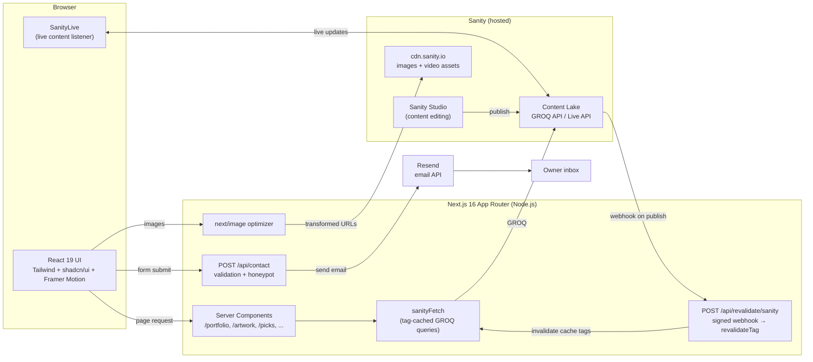

# Designed By Been

Portfolio website for Designed By Been, owned and operated by Benji Dunn LLC.

## Purpose

Designed By Been is the online portfolio of Brittany Been, an interior designer and architect based in Phoenix, AZ. The site:

- **Shows design work.** Residential and commercial projects, each with a cover image, gallery, video, and credits (location, architect, designer).
- **Shows artwork.** A full-screen, swipeable carousel of original pieces.
- **Shares "Picks".** A curated board of recommended products, each linked to an external store. Picks can also be attached to individual projects.
- **Generates leads.** A validated contact form sends inquiries straight to the owner's inbox.

The owner edits content in a hosted **Sanity CMS**. Published changes appear on the live site within seconds, with no code change or redeploy.

## Technology Summary

| Area | Technology | Notes |
| --- | --- | --- |
| Language | **TypeScript 5** (strict) | Used in all application code, including types generated from the CMS schema |
| Markup / Styling languages | **TSX/JSX**, **CSS** | Tailwind v4 utility classes plus CSS custom-property design tokens in `app/theme.css` |
| Framework | **Next.js 16 (App Router)** | React Server Components, Route Handlers, `next/image`, `next/font`, tag-based cache revalidation |
| UI library | **React 19** | Mix of Server Components (data fetching) and Client Components (interactivity) |
| Styling | **Tailwind CSS 4** via `@tailwindcss/postcss` | Mobile-first responsive layouts |
| Component system | **shadcn/ui** (New York style) on **Radix UI** primitives | Button, Card, Dialog, Hover Card; uses `class-variance-authority`, `clsx`, `tailwind-merge` |
| Animation | **Framer Motion** | Artwork carousel gestures and transitions, scroll-reveal effects |
| Icons | **Lucide React** | |
| Typography | **IBM Plex Sans / Plex Mono** | Loaded through `next/font/google` |
| Headless CMS | **Sanity** (`next-sanity`, `@sanity/image-url`) | GROQ queries, Live Content API, image CDN transforms, webhooks |
| Type generation | **Sanity TypeGen** | Generates `sanity.types.ts` from the schema and GROQ queries |
| Transactional email | **Resend** | Sends contact form submissions |
| Linting | **ESLint 9** with `eslint-config-next` | |
| Runtime | **Node.js** | Next.js server for SSR, Route Handlers, and webhooks |

## Architecture Overview



### Request and content flow

1. **Rendering.** Pages are async React Server Components. They call `sanityFetch` (from `next-sanity/live`) with a typed GROQ query and one or more cache tags, for example `project`, `project:<slug>`, or `project-category:residential`.
2. **Caching and revalidation.** When content is published, Sanity sends an HMAC-signed webhook to `/api/revalidate/sanity`. The handler checks the signature with `SANITY_REVALIDATE_SECRET`, maps the document type to its cache tags, and calls `revalidateTag`, so only the affected pages are rebuilt.
3. **Live content.** `<SanityLive />` in the root layout listens for content changes and refreshes server-rendered data in the browser.
4. **Images.** Sanity image references are converted to CDN URLs with `@sanity/image-url` (`auto=format`, quality 80, explicit sizes), then rendered with `next/image`. `cdn.sanity.io` is allow-listed in `next.config.ts`.
5. **Contact.** The client-side form posts JSON to `/api/contact`. The server trims and validates the fields (email format and length limits), silently drops spam caught by a honeypot field, and sends a plain-text email through Resend with `replyTo` set to the sender.

### Content model (Sanity document types)

| Type | Used by | Key fields |
| --- | --- | --- |
| `project` | `/portfolio/residential`, `/portfolio/commercial`, `/portfolio/project/[slug]` | title, slug, category, summary, location, architect, designer, coverImage, gallery, videos, picks (refs) |
| `artwork` | `/artwork` | image (with dimensions), date |
| `pick` | `/picks`, project detail carousel | title, link, image |
| `siteSettings` | Global | title, Instagram/TikTok URLs |

## Project Structure

```
app/                      Next.js App Router routes (Server Components by default)
  layout.tsx              Root layout: fonts, header/footer, context provider, <SanityLive />
  page.tsx                Home page with full-bleed navigation panels
  about/ artwork/ contact/ picks/ portfolio/   Site sections
  portfolio/project/[slug]/   Dynamic project detail page
  api/contact/route.ts        Contact form handler (Resend)
  api/revalidate/sanity/route.ts  Sanity webhook → cache tag revalidation
  globals.css, theme.css  Tailwind entry point and semantic design tokens
components/               Feature components (carousels, grids, forms, header/footer)
  ui/                     shadcn/ui primitives (button, card, dialog, hover-card)
context/                  React context for shared site content
lib/
  site.ts                 Site config and navigation definition
  sanity/                 Client, env, GROQ queries, live fetch, image URL builder
sanity.types.ts           Types generated by Sanity TypeGen
docs/                     Feature design and implementation plans
public/                   Static images and favicon
```

## Engineering Practices

- **End-to-end type safety.** GROQ queries are written with `defineQuery`, and TypeGen produces typed results for every query.
- **Server-first rendering.** Data is fetched on the server. Only interactive pieces (carousels, forms, header menu, hover cards, video) are Client Components.
- **Security.** Webhooks require a valid signature. Secrets stay in server-only environment variables. Contact input is validated and length-limited on the server, and a honeypot field filters bots.
- **Responsive design and accessibility.** Layouts are mobile-first and built on Radix primitives, which provide keyboard and screen-reader support. The project's guardrails are in `.github/instructions/responsive-ui.instructions.md`.

## Environment Variables

| Variable | Purpose |
| --- | --- |
| `NEXT_PUBLIC_SANITY_PROJECT_ID` | Sanity project ID |
| `NEXT_PUBLIC_SANITY_DATASET` | Sanity dataset name |
| `SANITY_API_READ_TOKEN` | Optional; enables authenticated Live API reads |
| `SANITY_REVALIDATE_SECRET` | Shared secret for verifying Sanity webhooks |
| `RESEND_API_KEY` | Resend API key |
| `CONTACT_TO_EMAIL` | Address that receives contact form messages |
| `CONTACT_FROM_EMAIL` | Verified sender address used by Resend |

## Development

```bash
npm run dev
```

The local development server runs at `http://localhost:3000`.

## Validation

```bash
npm run build
```
